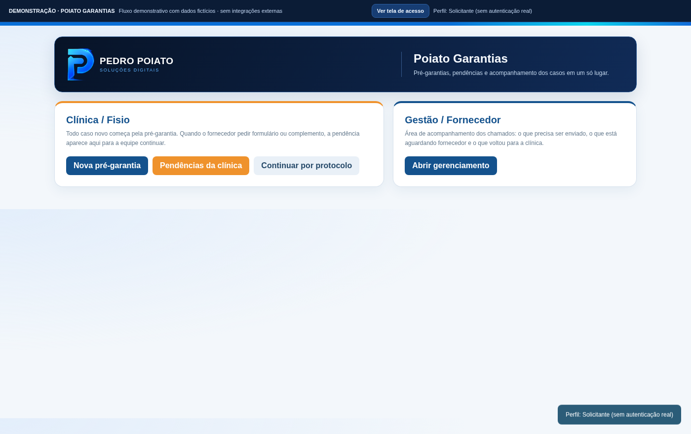

# Poiato Garantias — demonstração interativa V2

Protótipo público que apresenta o fluxo de uma central de pré-garantias e garantias. A solução original usa **Google Apps Script, HTML, CSS e JavaScript**; esta demonstração é independente e funciona inteiramente no navegador.

## O que testar

- Seleção de um perfil ilustrativo de acesso.
- Abertura de pré-garantias e geração de protocolo fictício.
- Consulta por protocolo e painel de pendências.
- Ficha do caso com produto, relato, anexos **simulados** e histórico.
- Movimentação entre etapas permitidas: envio ao fornecedor, pedido de complementos, aprovação/recusa, garantia formal e conclusão.
- Listas distintas para pré-garantias e garantias formais.
- Indicadores e filtros que acompanham os registros da sessão.
- Histórico geral de movimentações e reinício do cenário.

**[Abrir a demonstração no GitHub Pages](https://pedro-poiato.github.io/poiato-garantias-demo/)** (depois de ativar o Pages).

## Limitações

Todos os pacientes, fornecedores e números de série são inventados. Não existe login real, PIN, envio de e-mail, upload de anexos, aprovação de fornecedor, banco de dados ou integração com serviços externos. O perfil é apenas uma maneira de conhecer as telas. As mudanças são temporárias e desaparecem ao recarregar a página. O código corporativo original não está incluído.

Para testar localmente, abra `index.html` em um navegador.

Pedro Poiato — Soluções Digitais
